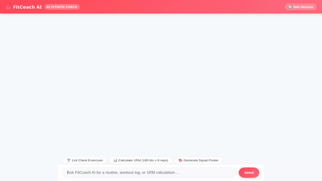

# 💪 FitCoach AI — Personal Fitness & Workout Assistant



**FitCoach AI** is an intelligent fitness, workout, and nutrition assistant built with Google's **Agent Development Kit (ADK)** and powered by **Google Gemini**. It helps athletes and fitness enthusiasts discover exercises, calculate training targets, log workout sessions, generate motivational visuals and exercise demonstration videos, search for nearby gyms, and remember personal preferences and strict health/allergy constraints across sessions.

---

## 🌟 Key Features & Capabilities

* **🏋️ Exercise Catalog & Management**: Queries and manages structured exercise guides (name, category, target muscles, equipment, difficulty, instructions) stored in **Google Cloud Firestore**.
* **📝 Workout Session Logging**: Logs completed workout sessions (exercise name, sets, reps, weight) directly into Firestore.
* **📊 1RM & Zone Calculations (Python Sandbox)**: Executes mathematical calculations in the Vertex AI Agent Engine **Python Code Execution Sandbox** to compute One-Rep Max (1RM) estimates and training load percentages (70%, 80%, 90%).
* **🌐 Public Exercise Guides Integration**: Fetches detailed exercise data and guides directly from the **wger REST API**.
* **📍 Gym & Fitness Spot Discovery**: Geocodes addresses and searches Google Maps Places API to locate nearby fitness centers and gyms.
* **🎨 AI Visual Generation**: Generates motivational workout posters using `gemini-3.1-flash-lite-image` and uploads them directly to public **Google Cloud Storage**.
* **🎥 AI Exercise Video Generation**: Generates exercise demonstration videos using Google's Omni model (`gemini-omni-flash-preview`) in the `global` region and uploads video bytes to Cloud Storage.
* **🧠 Cross-Session Memory (Vertex AI Memory Bank)**: Automatically extracts and remembers user fitness goals, workout history, dietary preferences, and strict allergy constraints across sessions using **Vertex AI Memory Bank**.
* **📱 Adaptive UI (A2UI)**: Formats exercise cards, workout logs, and calculation summaries into responsive UI components for both the ADK Web Dev UI and the custom frontend.
* **💬 Custom Web Frontend**: Includes a FastAPI proxy and responsive web interface featuring an energetic fitcoach coral theme (`#ff4757`), domain-tailored prompt chips, sender badges, and a new session reset button.

---

## 🛠️ Google Cloud & Architecture Stack

* **Core Framework**: ADK (Agent Development Kit) & `google-agents-cli`
* **Agent Engine**: Deployed on Vertex AI Agent Engine (`reasoningEngines`)
* **Long-Term Memory**: Vertex AI Memory Bank
* **Database**: Google Cloud Firestore
* **Media Storage**: Google Cloud Storage (Public Bucket)
* **Generative AI Models**:
  - `gemini-flash-latest` (Core Reasoning & Orchestration)
  - `gemini-3.1-flash-lite-image` (Image Generation)
  - `gemini-omni-flash-preview` (Video Generation)
* **Frontend Hosting**: Google Cloud Run (FastAPI A2A Proxy + Web UI)

---

## 🚀 Setup & Execution Guide

### Prerequisites
- Python 3.11+
- `google-agents-cli` (`uv tool install google-agents-cli` or `uvx google-agents-cli`)
- `gcloud` CLI authenticated with GCP permissions

### 1. Install Dependencies

```bash
git clone <your-repo-url>
cd fitcoach-ai
pip install -r pyproject.toml
```

### 2. Run Locally with ADK Web / Playground

To run the agent locally in the ADK Developer UI:

```bash
agents-cli playground
```

Or using `adk`:

```bash
adk web app
```

### 3. Run Custom Web Frontend Locally

To run the custom chat interface locally:

```bash
cd frontend
pip install -r requirements.txt
export AGENT_ENGINE_RESOURCE_NAME="projects/<PROJECT_NUM>/locations/us-east1/reasoningEngines/<ENGINE_ID>"
export AGENT_DIRECTORY="app"
python main.py
```

### 4. Deploy Frontend to Cloud Run

To deploy the custom frontend to Google Cloud Run:

```bash
cd frontend
gcloud run deploy fitcoach-ai-frontend \
  --source . \
  --region us-east1 \
  --allow-unauthenticated \
  --set-env-vars="AGENT_ENGINE_RESOURCE_NAME=$AGENT_ENGINE_RESOURCE_NAME,AGENT_DIRECTORY=$AGENT_DIRECTORY"
```
